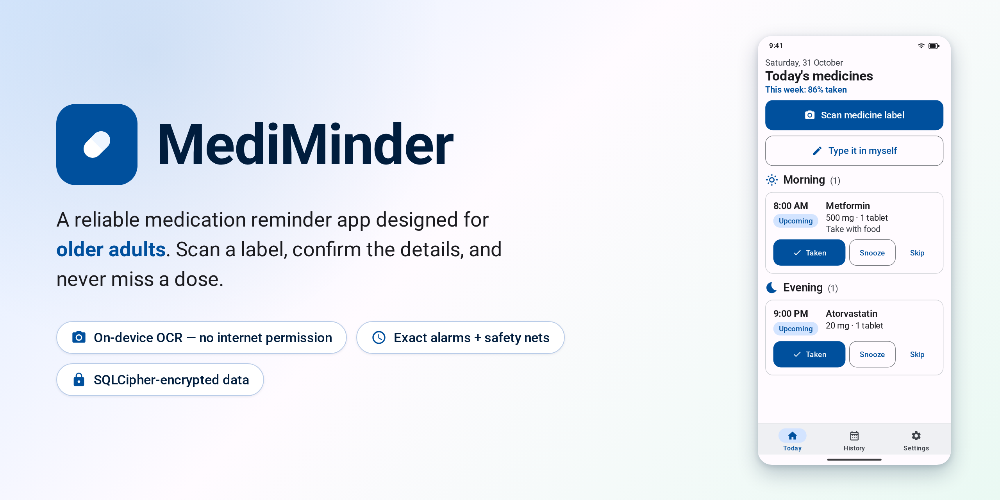
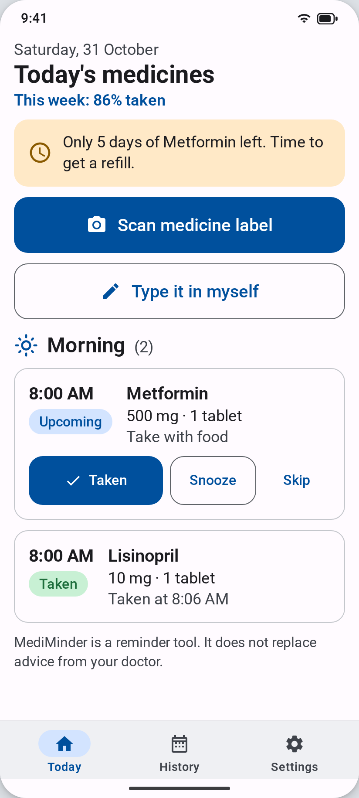
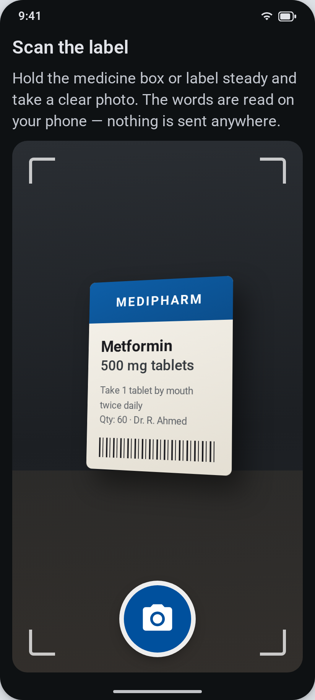
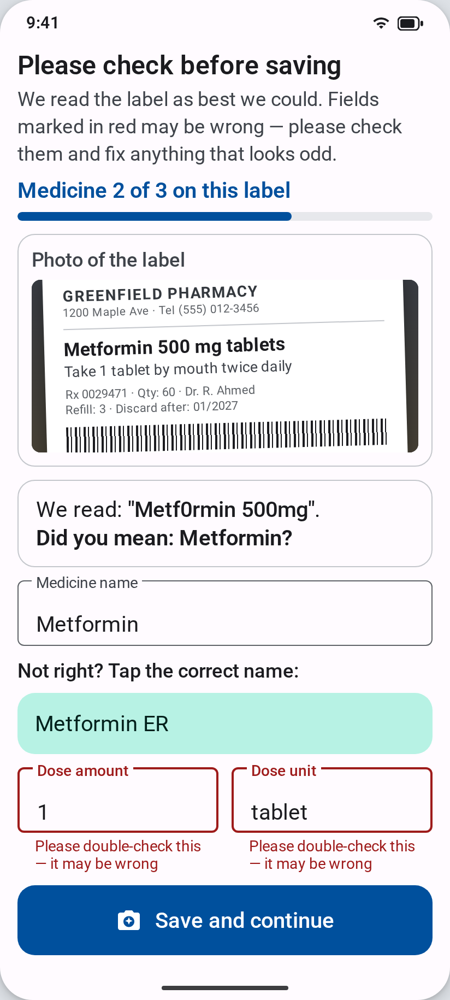
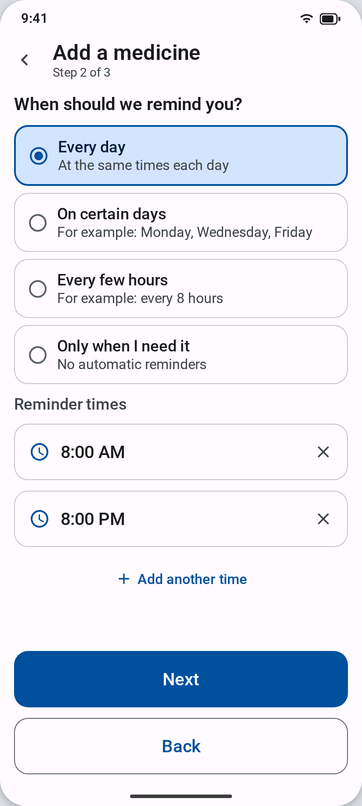
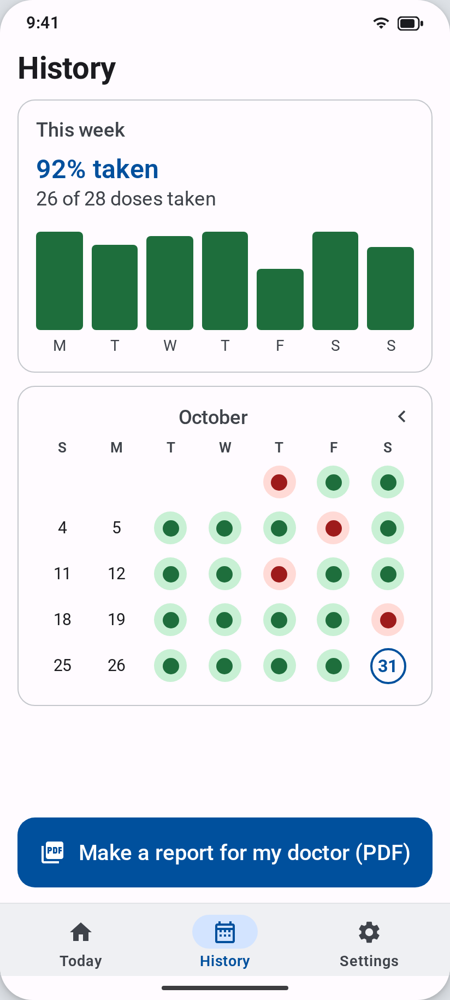
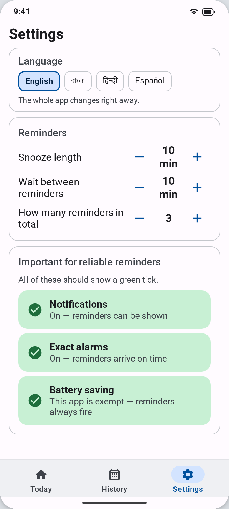
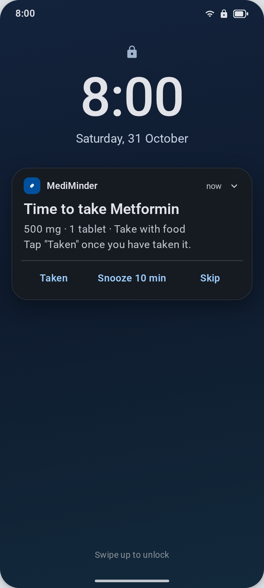
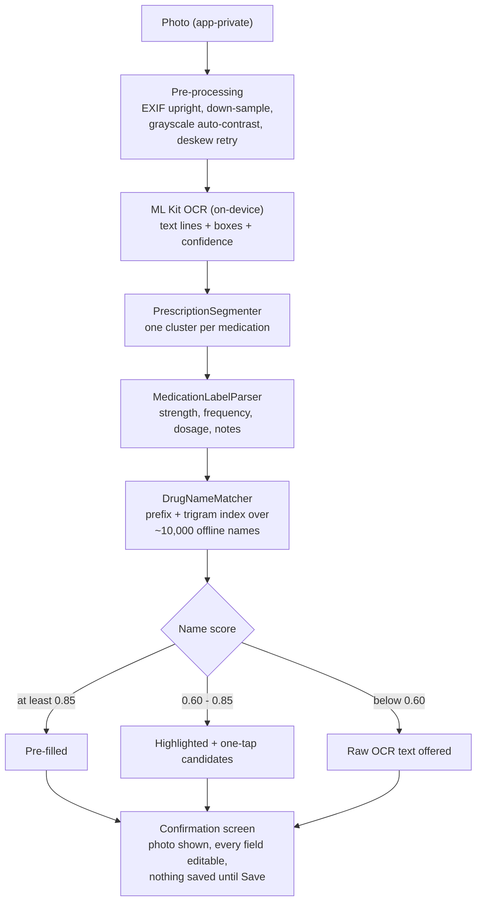

<p align="center">
  
</p>

<p align="center">
  <a href="https://github.com/touhidsiddiqueeraj-bit/mediminder/actions/workflows/ci.yml"></a>
  <a href="https://github.com/touhidsiddiqueeraj-bit/mediminder/actions/workflows/release.yml"></a>
  
  
  
  
</p>

**A reliable medication reminder app designed for older adults.**

Users add medicines by photographing the label (on-device OCR) or by typing
them in. MediMinder then fires exact, unmissable reminders with big, clear
text, and keeps a shareable adherence history.

> MediMinder is a reminder tool. It does not replace medical advice and never
> suggests changing a dose.

---

## Contents
- [Screenshots](#screenshots)
- [How label scanning works](#how-label-scanning-works)
- [Features](#features)
- [Languages](#languages)
- [Tech stack](#tech-stack)
- [Project structure](#project-structure)
- [Getting started](#getting-started)
- [Testing](#testing)
- [CI/CD](#cicd)
- [How reminders stay reliable](#how-reminders-stay-reliable)
- [Permissions rationale](#permissions-rationale)
- [Privacy](#privacy)
- [Accessibility](#accessibility)
- [Roadmap](#roadmap--phase-2-caregiver-support)
- [Manual QA](#manual-qa)

---

## Screenshots

| Today's medicines | Scan the label | Confirm before saving |
| :---: | :---: | :---: |
|  |  |  |
| One tap to mark a dose **Taken**, **Snooze** or **Skip**; low-stock banners warn before you run out. | Point at the box or prescription — text is read **on the phone**, nothing is uploaded. | Every field is editable; uncertain values are flagged red with one-tap dictionary candidates. |

| Add manually — step 2 of 3 | History & reports | Reliability dashboard |
| :---: | :---: | :---: |
|  |  |  |
| Big radio cards and time pickers — no fiddly dropdowns. | Weekly adherence, a month calendar, and a **PDF report** to share with the doctor. | Seven languages, one tap away — plus every permission that could delay a reminder, with a green tick when healthy. |

<p align="center">
  <br>
  <sub>The reminder itself: big text, a gentle chime, and <b>Taken / Snooze 10 min / Skip</b> right from the lock screen — or full-screen when the phone is locked.</sub>
</p>

> The images above are high-fidelity mockups rendered from the app's actual
> Compose layouts and Material 3 theme (see [`docs/SCREENSHOTS.md`](docs/SCREENSHOTS.md)
> for how they are produced and how to replace them with real device captures).

## How label scanning works

Prescriptions often list **several** medicines. One photo is segmented into
one cluster per medicine, each fuzzy-matched against an offline dictionary,
and each confirmed separately. Everything runs on the phone.



When OCR misreads a name ("Metf0rmin"), the fix is never silent: the screen
shows *We read: "Metf0rmin" — Did you mean: Metformin?* and the user taps the
right one. If a photo cannot be read at all, the app falls back to the manual
form **with the photo attached**.

## Features

| Area | What it does |
| --- | --- |
| **Add by photo** | CameraX photo → image pre-processing (EXIF upright, down-sample, grayscale auto-contrast, one deskew/auto-crop retry) → ML Kit on-device OCR → line clustering finds **one candidate per medication — prescriptions with several medicines are supported** → offline drug-name dictionary fuzzy-corrects OCR typos ("Metf0rmin" → "Metformin") with confidence bands (≥ 0.85 pre-filled, 0.60–0.85 highlighted with one-tap candidate chips, < 0.60 left blank with the raw text offered) → **confirmation screen with the photo and every field editable**, reviewed one medicine at a time. Falls back to the manual form with the photo attached if extraction fails. |
| **Add manually** | 3-step wizard: medicine → schedule → review. Forms: tablet/capsule/liquid/drops/injection. Frequencies: daily, specific weekdays, every X hours (crossing midnight), "every N days", as-needed. Optional end date, notes, pill count. "Check the name" button matches what you typed against the offline dictionary. |
| **Offline drug dictionary** | ~10,000 generic and brand names (~725 KB asset) rebuilt from the [openFDA NDC Directory](https://open.fda.gov/data/ndc/) (public domain), copied into Room on first use and searched with a prefix + trigram index — fully offline, brand → generic links included. Rebuild: `tools/rebuild_drug_dictionary.py`. |
| **Reminders** | Exact alarms (`setExactAndAllowWhileIdle`) with full-screen intent, big text, gentle custom chime + vibration, and **Taken / Snooze 10 min / Skip** actions. If unanswered, re-reminds up to 3× (configurable), then marks the dose **Missed**. |
| **Today screen** | Doses grouped Morning/Afternoon/Evening/Night with status chips and one-tap "Taken". Low-stock banners ("Only 3 days of Metformin left"). Optional voice read-out (TTS). |
| **History & reports** | Month calendar with per-day adherence, weekly summary, per-medicine stats, and an exportable **PDF report** for the doctor. |
| **Safety** | Warns when a new medicine shares an active ingredient with an existing one. Visible disclaimer everywhere. |
| **Languages** | The whole app speaks **English, বাংলা (Bangla), हिन्दी (Hindi), Español, Français, العربية (Arabic) and Português** — switchable in Settings with instant effect. The read-aloud voice follows the chosen language. |
| **Privacy** | All data in an **encrypted** database (SQLCipher + Android Keystore). Photos stay on the device and can be deleted right after extraction. No analytics, no tracking, no cloud backup by default. |

## Languages

MediMinder ships full translations (every screen, notification and spoken
sentence) for seven languages:

| Code | Language | Native name |
| --- | --- | --- |
| `en` | English | English (default) |
| `bn` | Bangla | বাংলা |
| `hi` | Hindi | हिन्दी |
| `es` | Spanish | Español |
| `fr` | French | Français |
| `ar` | Arabic (RTL) | العربية |
| `pt` | Portuguese | Português |

**How to switch:** Settings → Language → tap a chip. The whole app changes
immediately (on Android 13+ the language can also be set from the system's
per-app language picker, and Arabic mirrors the entire layout right-to-left).

Implementation notes:

- Per-app languages are applied with **AndroidX `AppCompatDelegate.setApplicationLocales`** — one code path for Android 8–12 (AppCompat backport) and Android 13+ (framework `LocaleManager`).
- The choice is also stored in DataStore, because on Android 8–12 the application context (used by notification receivers, workers and the PDF report) does **not** follow per-app locales — `Context.withAppLanguage()` re-applies it there, so reminders arrive in the user's language even when the app process was never opened.
- Date/time formatting goes through `appLocale()` (`util/AppLocales.kt`) for the same reason.
- Text-to-speech sets its language explicitly; if no voice is installed for the chosen language, the Today screen shows a hint with a shortcut to the system voice settings instead of failing silently.
- Notification **channel names** are a snapshot taken at creation (an Android limitation) — they keep the language of the first launch until the app is reinstalled; everything else re-translates instantly.
- Consistency of all translation files (key parity, format arguments, plural rules, apostrophe escaping) is machine-checked: `python3 tools/check_translations.py`.

## Tech stack

- **Kotlin** 2.0, **Jetpack Compose + Material 3**, minSdk 26, target/compileSdk 35
- **MVVM + Clean Architecture** layering, **Hilt** DI, KSP
- **Room** (offline-first) encrypted with **SQLCipher**
- **CameraX** + **ML Kit Text Recognition** (on-device, bundled Latin model)
- **AlarmManager** (exact) + **WorkManager** fallback, **NotificationCompat**
- **DataStore** preferences, **kotlinx.serialization** (dictionary asset)
- **Coil** for photo display, custom **PdfDocument** report generator (StaticLayout-based, so Bangla/Hindi/Arabic text renders correctly in the PDF)
- **AndroidX AppCompat** per-app language backport (7 UI languages, RTL support)

## Project structure

Single `:app` module today, with strict package layering (the proposed
multi-module evolution is in [`docs/ARCHITECTURE.md`](docs/ARCHITECTURE.md)):

```
app/src/main/java/com/mediminder/app/
├── domain/                    # pure Kotlin, no Android deps — 100% JVM-testable
│   ├── model/                 # Medication, Schedule, DoseLog, ParsedLabel, DrugName, enums
│   ├── parser/                # MedicationLabelParser, PrescriptionSegmenter, DrugNameMatcher
│   ├── engine/                # DoseGenerationEngine, AdherenceCalculator, LowStockCalculator
│   ├── repository/            # interfaces + ReminderSettings
│   ├── service/               # ReminderScheduler, OcrProvider, DrugNameIndex, ReRemindPolicy
│   └── usecase/               # Add/Mark/Snooze/Missed/Extract use cases
├── data/                      # implementations
│   ├── local/                 # Room entities, DAOs, converters, drug-name seeder
│   ├── repository/            # Medication/DoseLog/Settings repositories
│   ├── scanner/               # MlKitOcrProvider, image pre-processor, local dictionary index
│   ├── report/                # PDF report generator
│   └── mapper/
├── scheduling/                # AlarmScheduler, ReminderPlanner, ReminderTrigger,
│                              # Boot/Timezone/Update receiver, Maintenance + SafetyNet workers
├── notifications/             # channels + NotificationHelper
├── tts/                       # optional voice readout (language-aware, failure-surfacing)
├── util/                      # appLocale(), withAppLanguage() context helper
├── ui/                        # Compose: theme, components, navigation, screens
└── di/                        # Hilt modules
```

`app/src/main/assets/drug_names.jsonl` is the offline dictionary (see
[`tools/README.md`](tools/README.md) for how to rebuild it).

## Getting started

Requirements: **Android Studio Ladybug+**, JDK 17 (bundled), an Android device
or emulator on API 26+.

```bash
git clone https://github.com/touhidsiddiqueeraj-bit/mediminder.git
cd mediminder
./gradlew :app:assembleDebug
# install on a connected device
adb install app/build/outputs/apk/debug/app-debug.apk
```

There is no API key, no backend and no configuration step — the app is fully
offline-first.

### Troubleshooting local builds
- `SDK location not found` → create `local.properties` with
  `sdk.dir=/path/to/Android/sdk` (Android Studio does this automatically).
- JVM crashes on small machines → lower `org.gradle.jvmargs` in
  `gradle.properties`, or build with `--max-workers=1`.

## Testing

```bash
# Parser, dose engine, adherence, low stock, re-remind policy (JVM, fast)
./gradlew :app:testDebugUnitTest

# Instrumented UI + Room DAO tests (device/emulator needed)
./gradlew :app:connectedDebugAndroidTest

# Static analysis
./gradlew :app:lintDebug

# Translation consistency (key parity, format args, plurals, escaping)
python3 tools/check_translations.py
```

The parser test suite covers the label formats named in the spec
("Take 1 tablet by mouth twice daily", "500mg every 8 hours") plus sig
abbreviations (b.i.d./t.i.d./q.i.d./q8h), word numbers ("two tablets"),
ranges ("every 4–6 hours"), PRN medicines, bedtime/morning/evening phrasing,
bottle-size vs dose disambiguation, pharmacy-header noise, OCR-confusion
variants ("Metf0rmin 500mg", "Tab. Atorvastatln 10mg OD") and — critically —
**non-medication lines** (doctor names, addresses, dates) that must *not*
match any dictionary entry.

## CI/CD

Two workflows (`.github/workflows/`), plus Dependabot for dependencies:

| Workflow | Trigger | What it does |
| --- | --- | --- |
| **ci.yml** | push to `main`, PRs | Wrapper validation, `assembleDebug`, unit tests, lint, instrumented-test compile. Uploads the debug APK as an artifact for manual QA; test/lint reports on failure. |
| **release.yml** | tag `v*` or manual | Builds a signed release **APK + AAB** and publishes them to a GitHub Release with auto-generated notes. |

### Release signing (optional but recommended)

Add these repository secrets (Settings → Secrets and variables → Actions) and
the release workflow will sign properly; without them you still get a
debug-signed release APK for testing:

| Secret | Value |
| --- | --- |
| `KEYSTORE_BASE64` | `base64 -w0 your-release.keystore` |
| `KEYSTORE_PASSWORD` | keystore password |
| `KEY_ALIAS` | key alias |
| `KEY_PASSWORD` | key password |

Cut a release:

```bash
git tag v1.0.0 && git push origin v1.0.0
```

## How reminders stay reliable

A missed notification is the worst possible failure for this app, so the
design assumes everything will try to stop it:

1. **Exact alarms.** `setExactAndAllowWhileIdle(RTC_WAKEUP, …)` — fires in
   Doze mode, to the second.
2. **Dose materialization.** `DoseGenerationEngine` (pure, unit-tested)
   materializes dose rows for today + 2 days ahead. Rows are idempotent
   (unique index on medication + scheduled time), so replanning never
   duplicates or double-fires.
3. **Re-register after every disruption.** `DeviceEventReceiver` listens for
   `BOOT_COMPLETED`, `TIMEZONE_CHANGED`, `TIME_SET` and
   `MY_PACKAGE_REPLACED` and replans all alarms.
4. **Re-remind chain.** On fire: notify → count attempt → re-arm after
   10 min (configurable) → after the configured budget, mark **Missed**
   and fire the caregiver event hook.
5. **WorkManager safety nets.** A 6-hour `MaintenanceWorker` (sweeps missed
   doses, replans, low-stock warnings) plus a 30-minute `SafetyNetWorker`
   that is armed *only* while the exact-alarm permission is missing.
6. **Permission-degradation path.** No exact-alarm permission → inexact
   Doze-tolerant alarms + the safety net; no notification permission →
   Settings shows a red card with a one-tap fix.
7. **Idempotent planner.** `rescheduleAllAlarms()` is safe to call at any
   time (app start, after every edit, boot, timezone change) — same
   request codes replace their alarms instead of stacking.

## Permissions rationale

| Permission | Why |
| --- | --- |
| `POST_NOTIFICATIONS` | The reminder itself. |
| `SCHEDULE_EXACT_ALARM` | Exact fire time. On Android 12+ the user is guided to grant it; the app degrades to inexact alarms + WorkManager if denied. |
| `USE_FULL_SCREEN_INTENT` | Full-screen reminder when the phone is locked (only used when opened from a reminder — health data is never shown on the lock screen otherwise). |
| `RECEIVE_BOOT_COMPLETED` | Re-register alarms after reboot. |
| `VIBRATE` / `WAKE_LOCK` | Alert pattern; firing from Doze. |
| `CAMERA` | Photograph the medicine label. Optional: manual entry works without it. |
| — | No `INTERNET` permission at all: the app physically cannot send data anywhere. The drug dictionary ships inside the APK. |
| `REQUEST_IGNORE_BATTERY_OPTIMIZATIONS` | Guided exemption so OEM battery managers cannot defer alarms. |

## Privacy

- Medicine data lives in a **SQLCipher-encrypted** Room database; the
  passphrase is generated once and encrypted with an AES/GCM key that never
  leaves the Android Keystore.
- Photos are captured into app-private storage, processed on-device, and can
  be deleted immediately after saving (default on).
- `allowBackup=false` and empty backup rules — nothing leaves the device
  unless the user explicitly shares the PDF report.
- No analytics, ads or third-party trackers of any kind.
- In-app privacy policy screen (plain language). GDPR/HIPAA principles by
  design: data minimization, on-device processing, explicit opt-in for
  anything remote.

## Accessibility

- Body text ≥18sp (all typography in `sp`); layouts survive system font
  scale up to 200% (no fixed heights on text, generous spacing).
- High-contrast light/dark palettes targeting WCAG AAA body-text contrast.
- All touch targets ≥56dp (buttons ≥64dp); icons always carry text labels.
- Full TalkBack support: content descriptions, merged semantics on dose
  cards, state descriptions on status chips, heading semantics.
- Plain, friendly language throughout; optional TTS read-out of reminders
  and of the day's plan.
- Onboarding includes a guided, skippable permission walkthrough.

## Roadmap — Phase 2 caregiver support

The data layer is already wired for it: every taken/missed dose flows through
the `DoseEventListener` interface (bound to a no-op implementation today).
Adding "notify a family member if a dose is missed" means writing one class
(SMS gateway or push) and replacing the DI binding — see
[`docs/ARCHITECTURE.md`](docs/ARCHITECTURE.md#caregiver-support-phase-2).

## Manual QA

Before every release, walk through [`docs/QA-CHECKLIST.md`](docs/QA-CHECKLIST.md)
(Doze, reboot, timezone change, permission denials, OEM battery managers,
TalkBack, font scaling).
